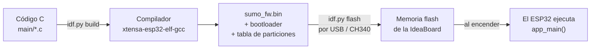

# 1. Qué es C y ESP-IDF

## El lenguaje C

C es un lenguaje **compilado**: el código que escribimos (`.c`) se traduce **antes** de usarlo a
instrucciones de máquina que el procesador ejecuta directamente. Por eso es muy rápido y se usa
en casi todo el software embebido (lavadoras, autos, drones, robots).

Comparado con CircuitPython (lo que trae el kit):

| | CircuitPython | C con ESP-IDF |
|---|---|---|
| Cómo corre | un intérprete lee el código línea por línea en la placa | el código ya está traducido a máquina |
| Velocidad | más lenta, con pausas del recolector de basura | rápida y predecible |
| Cambiar el código | editar `code.py` en Thonny y guardar | editar, **compilar** y **flashear** |
| Errores | aparecen al correr | muchos se detectan al compilar |

Conceptos de C que aparecen en el proyecto:

- **`#include`**: trae funciones de otras bibliotecas (por ejemplo `driver/gpio.h` para los pines).
- **`#define`**: constantes con nombre. Todo `config.h` son `#define`.
- **Funciones**: `void drive(float left, float right)` recibe dos números y no devuelve nada.
- **Tipos**: `int` (entero), `float` (decimal), `bool` (verdadero/falso), `int64_t` (entero de 64 bits,
  para tiempos en microsegundos).
- **`static`**: la variable o función solo existe dentro de su archivo. Así cada módulo esconde sus
  detalles.
- **`.h` y `.c`**: el `.h` (cabecera) dice *qué* funciones existen; el `.c` dice *cómo* funcionan.
  En este proyecto todas las cabeceras están juntas en `robot.h`.
- **`enum`**: lista de estados con nombre (`ST_SEARCH`, `ST_ATTACK`, ...).
- **`volatile`**: avisa al compilador que una variable puede cambiar "sola" (la cambia una
  interrupción), así que siempre debe leerla de memoria.

## El microcontrolador ESP32

El ESP32 es una computadora completa en un chip: 2 núcleos a 240 MHz, 520 KB de RAM, WiFi y
Bluetooth. No tiene sistema operativo como Windows: el programa que cargamos es **lo único** que
corre, desde que se enciende hasta que se apaga.

Periféricos que usa este firmware:

| Periférico | Qué hace | Lo usamos para |
|---|---|---|
| **GPIO** | pines digitales (0/1) | botón BOOT, TRIG y ECHO del ultrasónico |
| **LEDC** | genera PWM (pulsos de ancho variable) | velocidad de los motores |
| **ADC** | convierte voltaje a número | los 4 sensores IR |
| **RMT** | genera pulsos con tiempos exactos | el LED WS2812B |
| **I2C** | bus de comunicación de 2 cables | la IMU |
| **Interrupciones** | ejecutan código al instante cuando cambia un pin | medir el eco del ultrasónico |
| **esp_timer** | reloj en microsegundos | medir tiempos sin detener el programa |

## ESP-IDF

**ESP-IDF** (Espressif IoT Development Framework) es el kit oficial del fabricante del ESP32.
Incluye el compilador, los drivers de todos los periféricos, FreeRTOS y la herramienta `idf.py`.

```
idf.py set-target esp32   # una vez: preparar el proyecto para el ESP32
idf.py build              # compilar: C -> archivo .bin
idf.py -p COM5 flash      # flashear: escribir el .bin en la placa
idf.py -p COM5 monitor    # ver lo que imprime la placa (salir con Ctrl+])
```

## FreeRTOS

ESP-IDF trae **FreeRTOS**, un sistema operativo de tiempo real muy pequeño. Permite tener varias
**tareas** que corren "al mismo tiempo" (se turnan muy rápido o usan los 2 núcleos):

- `vTaskDelay(ms)`: duerme la tarea actual y deja correr a las demás.
- `vTaskDelayUntil(...)`: duerme hasta un instante exacto. Con esto el ciclo de control corre cada
  5 ms exactos.
- `xTaskCreate(...)`: crea otra tarea. Aquí el ultrasónico tiene su propia tarea.
- **Watchdog**: un vigilante que reinicia la placa si una tarea deja de "reportarse". Protege contra
  programas colgados.

## Compilar y flashear



Flashear **borra CircuitPython** y todo lo que tenía la placa (`code.py`, `/lib`). Se puede volver
atrás: ver [Instalar y cargar](04-instalar-y-flashear.md#volver-a-circuitpython).
