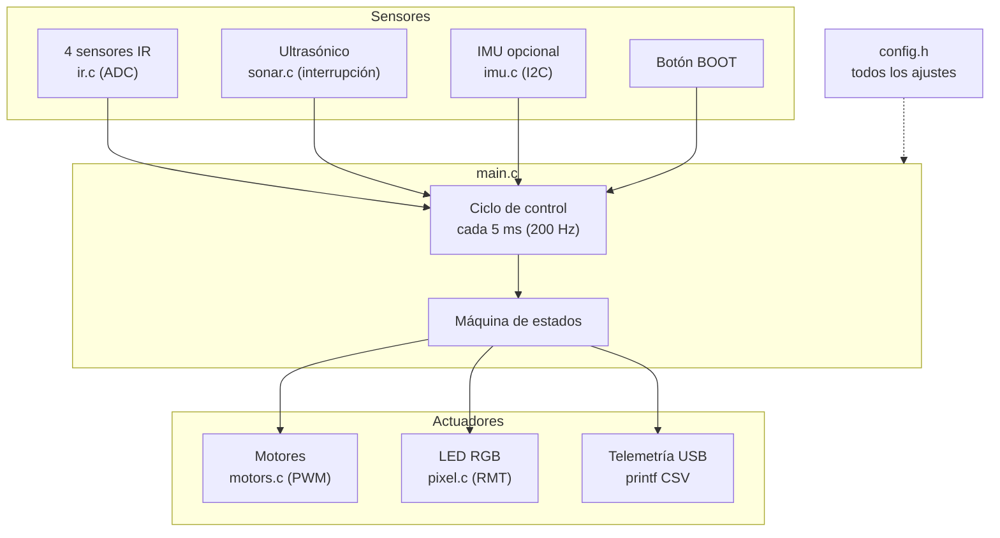
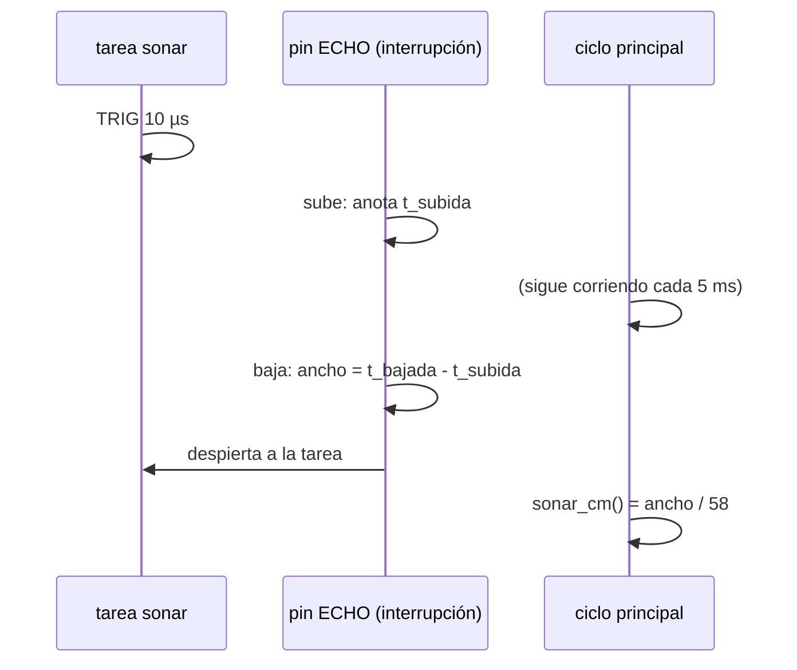
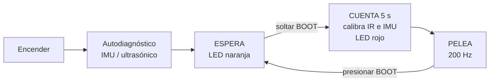
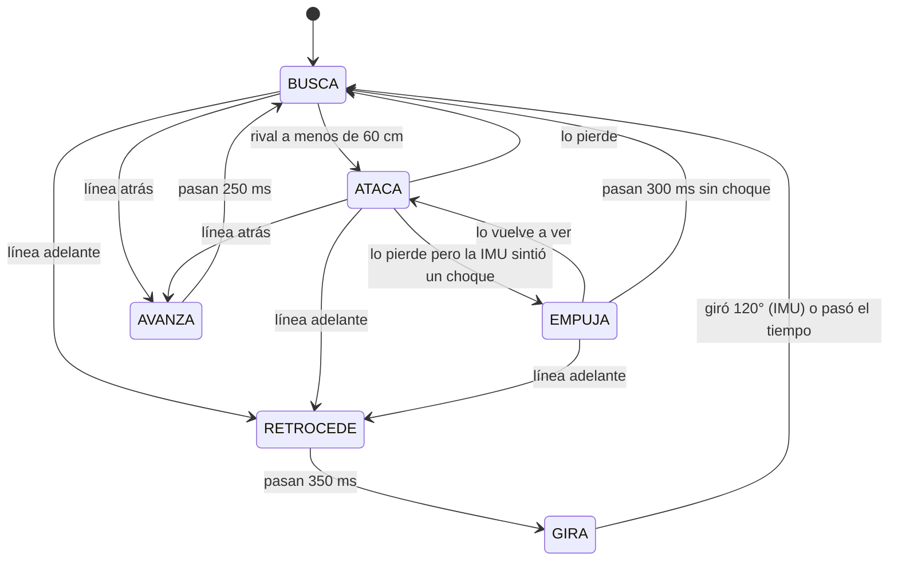

# 2. Arquitectura del sistema

## Vista general



## Dos tareas en paralelo

| Tarea | Núcleo | Qué hace |
|---|---|---|
| **main** (`app_main` → `fight`) | 0 | lee sensores, decide y mueve motores cada 5 ms |
| **sonar** (`sonar_task`) | 1 | dispara el ultrasónico una y otra vez y guarda la última distancia |

¿Por qué separarlas? El eco del ultrasónico puede tardar hasta ~30 ms. Si el ciclo principal lo
esperara (como pasaba en CircuitPython), el robot estaría "ciego" a la línea blanca durante ese
tiempo. Aquí la tarea `sonar` mide por su cuenta, y la **interrupción** del pin ECHO anota la hora
exacta (en microsegundos) en que el eco sube y baja. El ciclo principal solo lee el último valor,
lo que tarda microsegundos.



## Fases del programa



## Máquina de estados de la pelea

Cada 5 ms el programa decide en qué estado está. **La línea blanca tiene prioridad sobre todo.**



| Estado | Motores | LED |
|---|---|---|
| BUSCA | gira en su lugar (izq +0.35, der −0.35) | azul |
| ATACA | ambos a fondo hacia adelante | verde |
| EMPUJA | ambos a fondo (solo con IMU) | blanco |
| RETROCEDE | ambos hacia atrás a 0.8 | rojo |
| GIRA | gira hacia el lado contrario a la línea | (rojo) |
| AVANZA | ambos a fondo hacia adelante | amarillo |

## Un ciclo de control, paso a paso

1. **Esperar** hasta que se cumplan 5 ms exactos desde el ciclo anterior (`vTaskDelayUntil`).
2. **Alimentar el watchdog** (`esp_task_wdt_reset`). Si el programa se cuelga 2 s, la placa se reinicia.
3. **¿BOOT presionado?** → frenar y volver a ESPERA.
4. **Leer sensores**: 4 IR en milivoltios, IMU (si hay), última distancia del ultrasónico.
5. **Revisar la línea blanca** (adelante o atrás) → si la hay, empezar una maniobra de escape.
6. **Máquina de estados**: decidir y mandar velocidades a los motores y color al LED.
7. **Telemetría**: cada 50 ms imprimir una línea CSV por USB.

## Autocalibración de los sensores IR

Cada sumo lee distinto (lo medimos en varios robots del kit). Por eso, durante la cuenta de 5 s,
con el robot quieto **sobre negro**, se promedian cientos de lecturas por sensor y se calcula su
umbral:

```
si negro < 300 mV           -> sensor DAÑADO (sin 3V3/GND): se ignora y el LED parpadea morado
si negro > 2800 mV          -> sensor saturado: umbral = 2518 mV (el valor ajustado en CircuitPython)
si no, sensores delanteros  -> umbral = negro × 0.75
       sensores traseros    -> umbral = negro × 0.50   (mínimo 300 mV)

blanco = lectura < umbral
```

En estos sensores el **blanco da voltaje bajo** (~140–200 mV) y el **negro da voltaje alto**.
