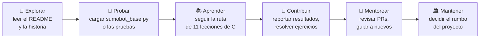

# Mapa de comunidad

## Dominio

**Aprender C y software embebido programando un sumobot real.** La comunidad reúne a quienes
quieren entender *por qué* funciona (o falla) su robot y convertir ese aprendizaje en material que
le sirva al siguiente estudiante.

**Propósito:** que nadie vuelva a descubrir solo lo que otro ya resolvió (el pin equivocado del IR,
la librería lenta del ultrasónico, los umbrales distintos en cada robot) y que el robot sea la
excusa para aprender C de verdad.

## Trayectorias de participación

Cada persona entra por donde le resulte cómodo y puede avanzar cuando quiera.

| Trayectoria | Qué hace la persona | Primer paso concreto | Tiempo | Necesita |
|---|---|---|---|---|
| 👀 **Explorar** | Entiende qué es el proyecto y qué problemas resolvió | Leer [README](../README.md) y [Historia](07-historia.md) | 10 min | Nada |
| 🔧 **Probar** | Diagnostica o pone a pelear su robot | Cargar [`sumobot_base.py`](../circuitpython/sumobot_base.py) en Thonny | 30 min | Robot del kit + Thonny |
| 📚 **Aprender** | Aprende C con el código del robot | [Lección 1](08-aprende-c.md#lección-1--constantes-con-define) | 1 lección por sesión | ESP-IDF instalado |
| 🤝 **Contribuir** | Comparte resultados, soluciones o mejoras | Abrir un Issue **"Resultado de prueba"** o resolver un ejercicio con un PR | 15 min – 1 tarde | Cuenta de GitHub |
| 🧭 **Mentorear** | Ayuda a otros a entrar | Responder Issues y revisar PRs de principiantes | 1 h por semana | Haber contribuido antes |
| 🏛️ **Mantener** | Decide qué se integra y hacia dónde va | Ver el [plan de sostenibilidad](plan-de-sostenibilidad.md#roles) | Variable | Ser mentor activo |

## Quién participa

| Perfil | Qué busca | Qué aporta |
|---|---|---|
| Estudiante del curso Sumobot | Que su robot funcione y gane | Pruebas en robots reales, fotos, resultados |
| Estudiante que aprende C | Un proyecto concreto para practicar | Soluciones a ejercicios, preguntas que mejoran las lecciones |
| Docente o mentor | Material para enseñar embebidos | Lecciones nuevas, correcciones, retroalimentación |
| Maker con otro robot ESP32 | Reutilizar módulos (ultrasónico por interrupción, autocalibración) | Adaptaciones a otro hardware |

## Espacios de la comunidad

- **Issues:** dudas, errores, resultados de prueba y propuestas (con plantillas).
- **Pull Requests:** toda contribución de código o documentación.
- **Documentación (`docs/`):** el conocimiento acumulado; cada aprendizaje termina aquí.

