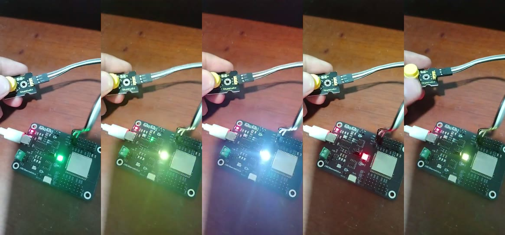
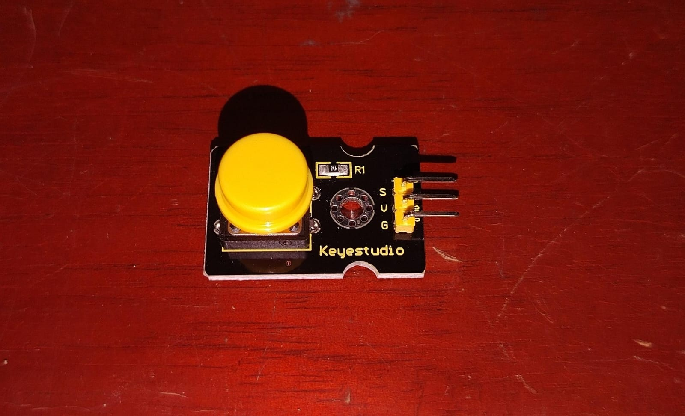
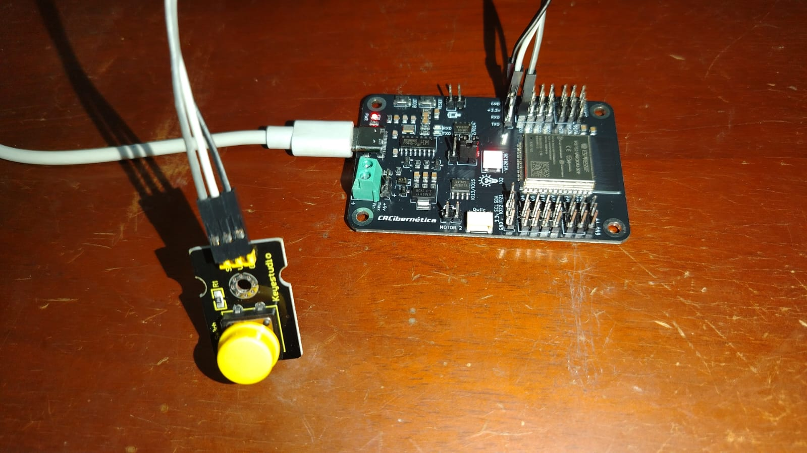
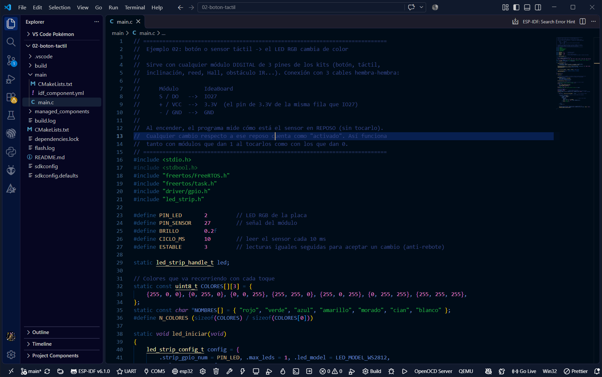

# Práctica 02 · Pulsador digital (Digital Push Button Module)

Cada vez que presionas el pulsador, el LED RGB de la IdeaBoard cambia de color. Mientras lo mantienes
presionado, el LED brilla fuerte.



| | |
|---|---|
| **Nivel** | 🟢 Básico (después de la [práctica 01](../01-led-rgb/)) |
| **Tiempo** | 20 minutos |
| **Aprendes** | entradas digitales, resistencias *pull-up* / *pull-down*, anti-rebote, flancos |

---

## 1. Explicación

Un **pulsador** es un interruptor que solo conecta mientras lo presionas. El módulo de Keyestudio
trae el botón y una resistencia (**R1**) ya soldados, y tiene 3 pines:

| Pin | Qué es |
|---|---|
| **S** | señal: lo que lee la IdeaBoard (0 o 1) |
| **V** | alimentación (3.3 V) |
| **G** | tierra (GND) |

En nuestra prueba el módulo dio **1 suelto y 0 presionado**: la resistencia R1 funciona como
***pull-up*** y mantiene la señal en 1 hasta que el botón la une con tierra.

Otros módulos de los kits funcionan al revés (dan 1 al activarse). Por eso el programa, al arrancar,
**aprende cómo está el sensor en reposo** y toma cualquier cambio como "activado". Así el mismo código
sirve para el pulsador, el sensor táctil, el de inclinación, el reed o el Hall.

**Rebote:** al presionar, el contacto metálico vibra y por unos milisegundos da varios 0 y 1 seguidos.
Si el programa no lo filtra, cuenta una pulsación varias veces. Este programa solo acepta un cambio si
se repite **3 lecturas seguidas** (30 ms).

---

## 2. Materiales

| Material | Cantidad |
|---|---|
| IdeaBoard de CRCibernética | 1 |
| Digital Push Button Module (Keyestudio, capuchón amarillo) | 1 |
| Cables hembra-hembra | 3 |
| Cable USB-C de datos | 1 |



---

## 3. Conexión

**Desconecta el USB antes de cablear.**

| Pin del módulo | Pin de la IdeaBoard |
|---|---|
| **S** | **IO27** |
| **V** | **3.3V** (en la misma fila que IO27) |
| **G** | **GND** (en la misma fila que IO27) |

> ⚠️ Usa el pin **3.3V**, no **V+** ni **Vin**: esos pueden llevar el voltaje de la batería, y la
> IdeaBoard trabaja a 3.3 V.



---

## 4. El programa

Código completo: [`main/main.c`](main/main.c). Las partes importantes:

**Configurar IO27 como entrada:**

```c
gpio_config_t entrada = {
    .pin_bit_mask = 1ULL << PIN_SENSOR,     // IO27
    .mode = GPIO_MODE_INPUT,
    .pull_down_en = GPIO_PULLDOWN_ENABLE,   // evita lecturas al azar si no hay nada conectado
};
gpio_config(&entrada);
```

**Aprender el reposo** (20 lecturas sin tocar el botón):

```c
int unos = 0;
for (int i = 0; i < 20; i++) {
    unos += gpio_get_level(PIN_SENSOR);
    vTaskDelay(pdMS_TO_TICKS(10));
}
int reposo = (unos > 10) ? 1 : 0;
```

**Anti-rebote y flanco** (cada 10 ms):

```c
bool lectura = gpio_get_level(PIN_SENSOR) != reposo;   // true = distinto al reposo
if (lectura != activado) {
    if (++iguales >= ESTABLE) {        // el cambio se repitió 3 veces: es real
        activado = lectura;
        if (activado) {                // justo se presionó
            toques++;
            color = (color + 1) % N_COLORES;
        }
    }
} else {
    iguales = 0;
}
```

| Constante | Valor | Qué controla |
|---|---|---|
| `PIN_SENSOR` | 27 | pin donde va la señal **S** |
| `ESTABLE` | 3 | lecturas iguales para aceptar un cambio (anti-rebote) |
| `CICLO_MS` | 10 | cada cuántos milisegundos se lee el pulsador |
| `BRILLO` | 0.2 | brillo del LED mientras está presionado |

---

## 5. Cómo correr el programa

Requisito: tener instalado ESP-IDF y la extensión de VS Code
([guía, parte 3](../../docs/guia-correr-c.md#3-instalar-las-herramientas)).

1. En VS Code: **File → Open Folder** → esta carpeta (`practicas-aplicables/02-pulsador-digital`).
2. Espera a que la **barra azul de abajo** diga **ESP-IDF v6.1.0**. Si no, **Ctrl+Shift+P → ESP-IDF:
   Select Current ESP-IDF Version → v6.1**.
3. Conecta la IdeaBoard por USB. En la barra, haz clic en 🔌 y elige **USB-SERIAL CH340 (COMx)**.
4. Clic en ⚙️ **Build** → espera `Project build complete`.
5. Clic en ⚡ **Flash** (método **UART**) → espera `Hash of data verified`.
6. Clic en 🖥️ **Monitor**. **No toques el botón el primer segundo**: la placa mide el reposo.
7. Presiona el botón. Para salir del Monitor: **Ctrl+]**.



*En la captura la carpeta todavía se llamaba `02-boton-tactil`; es el mismo proyecto.*

> Si al hacer **Flash** sale "Corrupt data" o "Packet content transfer stopped", baja la velocidad a
> 115200: **Ctrl+Shift+P → Preferences: Open Workspace Settings (JSON)** y agrega
> `"idf.flashBaudRate": "115200"`.

---

## 6. Resultado esperado

**En el Monitor:**

```
No toques el sensor: midiendo el reposo...
Reposo = 1. Listo: toca o presiona el sensor.
Toque #1 -> verde
Soltado
Toque #2 -> azul
Soltado
```

**En la placa:** el LED queda **rojo tenue** esperando. Con cada pulsación pasa a verde → azul →
amarillo → morado → cian → blanco → rojo…, y brilla fuerte mientras mantienes el botón.

🎥 **Video:** [img/video-pulsador.mp4](img/video-pulsador.mp4) (13 s, sin audio).

---

## 7. Retos

1. Cambia `ESTABLE` a 1. ¿Aparecen pulsaciones "fantasma" al presionar rápido?
2. Haz que **mantener presionado 1 segundo** apague el LED.
3. Cambia el pulsador por el **sensor táctil** (OSOYOO, placa roja; su pin **DO** va a IO27) sin cambiar
   el código. ¿Qué reposo mide?

---

## 8. Estado y créditos

✅ **Probado** en una IdeaBoard real con el Digital Push Button Module de Keyestudio: 17 pulsaciones
seguidas, cada una registrada una sola vez y con su "Soltado".

- Módulo pulsador: [Keyestudio](https://www.keyestudio.com/).
- IdeaBoard y referencia de pines: [CRCibernética](https://github.com/CRCibernetica/espressif-ideaboard) (MIT).
- ESP-IDF y driver `led_strip`: [Espressif Systems](https://github.com/espressif/esp-idf) (Apache 2.0).
- Fotos y video: Pablo Hernández.
